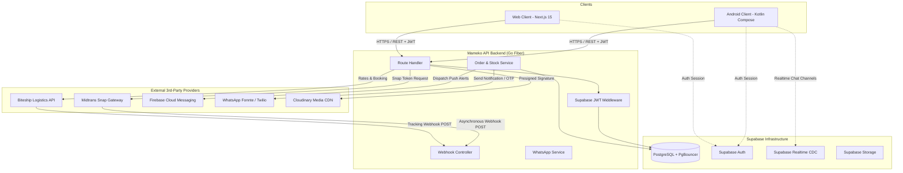

# Mameko Ecosystem Integration Standard & Runbook

Dokumen standar arsitektur dan runbook teknis untuk seluruh integrasi lintas komponen dalam ekosistem **Mameko**:
- **Android Native Client** (`mameko-app` - Kotlin + Jetpack Compose + Clean Architecture)
- **Web Application Client** (`mameko-web` - Next.js 15 App Router + TypeScript + Cloudflare Pages)
- **Golang Backend API** (`mameko-backend` - Go Fiber + pgx/stdlib + Supabase PostgreSQL)
- **External Gateways & Services**: Midtrans Snap, Biteship Logistics, WhatsApp Gateway (Fonnte/Twilio), Cloudinary CDN, Firebase Cloud Messaging (FCM), serta Supabase Platform (Auth, Database, Storage, Realtime).

---

## 1. Topologi Arsitektur & Matriks Integrasi

### 1.1 Diagram Alir Data Global



### 1.2 Matriks Kontrak Integrasi

| Provider / Channel | Komponen Terlibat | Metode / Protokol | Kredensial / Secret | Fungsi Utama |
| :--- | :--- | :--- | :--- | :--- |
| **Midtrans Snap** | Backend (`order.go`), Android (`PaymentWebScreen`), Web (`midtrans.ts`) | REST JSON + Webhook + WebView / Snap.js | `MIDTRANS_SERVER_KEY`, `MIDTRANS_CLIENT_KEY`, `store_config.midtrans_is_production` | Pembayaran digital (GoPay, ShopeePay, VA, QRIS, Kartu Kredit) |
| **Biteship Logistics** | Backend (`biteship.go`, `webhooks.go`), Android (`CheckoutRepo`) | REST JSON + Webhook | `BITESHIP_API_KEY`, `BITESHIP_WEBHOOK_SECRET` | Kalkulasi ongkir, pencarian area, auto-booking kurir, sinkronisasi resi |
| **WhatsApp Gateway** | Backend (`whatsapp.go`, `auth.go`), Android (`WhatsAppOtpScreen`) | REST HTTP POST (Fonnte) | `FONNTE_TOKEN`, `WHATSAPP_API_URL` | Pengiriman OTP verifikasi pendaftaran & notifikasi status pesanan |
| **Cloudinary Media** | Backend (`cloudinary.go`), Client (`UploadApiService`) | Presigned Signature + Multipart Upload | `CLOUDINARY_API_KEY`, `CLOUDINARY_API_SECRET`, `CLOUDINARY_CLOUD_NAME` | Upload bukti retur barang, review foto produk, avatar, & attachment chat |
| **Firebase (FCM)** | Backend (`notifications.go`), Android (`NotificationApiService`) | REST + Google Play Services | Service Account JSON / Server Key | Push notification latar belakang untuk update pesanan & pesan chat |
| **Supabase Platform** | All Components | REST + PostgreSQL Wire + WebSockets | `SUPABASE_URL`, `SUPABASE_ANON_KEY`, `SUPABASE_SERVICE_ROLE_KEY` | Autentikasi JWT, single source of truth database, Realtime chat |

---

## 2. Standar Integrasi Midtrans Payment Gateway

### 2.1 Alur Transaksi & Snap Token Lifecycle

```
[Client (Android/Web)]
   │
   ├─► 1. POST /api/user/orders (Checkout Data + Item List + Idempotency-Key)
   │      │
   │      ▼
   │  [Golang Backend]
   │      │
   │      ├─► 2. Validasi Stok Produk & Kunci Baris (SELECT FOR UPDATE)
   │      ├─► 3. Hitung Total Tagihan & Kompensasi Rounding 1-Rupiah
   │      ├─► 4. Simpan Pesanan ke DB (status: 'pending')
   │      ├─► 5. Request Snap Token ke Midtrans Snap API
   │      │      URL: https://app.midtrans.com/snap/v1/transactions (Prod)
   │      │      URL: https://app.sandbox.midtrans.com/snap/v1/transactions (Sandbox)
   │      │
   │      ▼
   ├─◄ 6. Return { success: true, snap_token: "...", redirect_url: "..." }
   │
   ├─► 7. Buka UI Pembayaran:
   │      - Android: Custom WebView (PaymentWebScreen) dengan intent deep link
   │      - Web: Lazy load Snap.js (loadMidtransSnap) -> snap.pay(token)
   │
   ▼
[Midtrans Engine]
   │
   └─► 8. POST /api/webhook/payment (Asynchronous Status Notification)
```

### 2.2 Penyesuaian Rounding 1-Rupiah (Snap Precision Guard)
Midtrans akan **menolak** request transaksi jika penjumlahan `sum(items.price * items.quantity)` tidak tepat sama dengan `gross_amount`. Di backend `internal/controllers/order.go`, penyesuaian harus selalu dilakukan:

```go
// intGross adalah gross_amount yang dibulatkan ke integer rupiah
diff := intGross - itemsSum
if diff != 0 && len(snapItems) > 0 {
    // Sesuaikan perbedaan 1-rupiah pada item diskon atau item terakhir
    for i := range snapItems {
        if snapItems[i].ID == "DISCOUNT" {
            snapItems[i].Price += diff
            itemsSum += diff
            break
        }
    }
    if itemsSum != intGross {
        snapItems[len(snapItems)-1].Price += diff
        itemsSum += diff
    }
}
```

### 2.3 Validasi Signature Webhook (Kriptografis SHA-512)
Setiap webhook notifikasi dari Midtrans wajib diverifikasi signature-nya sebelum memproses perubahan status:

```go
hashInput := fmt.Sprintf("%s%s%s%s", orderID, statusCode, grossAmount, serverKey)
hash := sha512.Sum512([]byte(hashInput))
expectedSignature := hex.EncodeToString(hash[:])

if !strings.EqualFold(signatureKey, expectedSignature) {
    return c.Status(fiber.StatusForbidden).JSON(fiber.Map{"error": "Invalid signature"})
}
```

### 2.4 State Machine Guard (Anti-Downgrade & Idempoten)
Webhook bisa tiba berulang kali (*at-least-once delivery*). Sistem wajib mencegah status mundur:
1. **Idempoten**: Jika order sudah berstatus `paid`, `processing`, atau `completed`, jangan ubah status lagi jika menerima settlement susulan. Return `{ success: true, idempotent: true }`.
2. **Anti-Cancel Protection**: Jika order sudah `paid` atau `shipped`, abaikan notifikasi `cancel` atau `expire` dari Midtrans. Return `{ ignored: true, message: "Order already processed" }`.
3. **Rollback Stok**: Kembalikan stok produk via `services.RestoreOrderStock(config.DB, orderID)` **hanya** jika status berubah dari `pending` ke `cancelled`, `expire`, atau `deny`.

### 2.5 Android Native WebView Deep Link Handling
Pada `PaymentWebScreen.kt`, WebView harus mengintersepsi URL skema pembayaran aplikasi lokal agar pengguna langsung dialihkan ke aplikasi dompet digital:
- `gojek://` -> Redirect ke aplikasi Gojek (GoPay)
- `shopeepay://` -> Redirect ke aplikasi Shopee (ShopeePay)
- `intent://` -> Eksekusi aman `Intent.parseUri(url, Intent.URI_INTENT_SCHEME)` dengan `CATEGORY_BROWSABLE`
- Whitelist host domain: `*.midtrans.com`, `*.gopay.co.id`, `*.shopeepay.co.id`, `*.mameko.my.id`. Blokir akses file lokal (`allowFileAccess = false`).

---

## 3. Standar Integrasi Biteship Logistics

### 3.1 Lifecycle Pengiriman & Sinkronisasi Resi

```
[Pengguna / Admin]
   │
   ├─► 1. Hitung Ongkir: POST /api/ongkir (asal kode pos toko, tujuan areaId, berat gram)
   │
   ├─► 2. Buat Pesanan: Alamat lengkap & biteship area ID tersimpan di orders.shipping_detail
   │
   ├─► 3. Pembayaran Lunas (status: 'paid')
   │
   ├─► 4. Admin Booking Kurir: POST /api/biteship/order atau Auto-Booking Service
   │      - Biteship mengembalikan `waybill_id` (nomor resi) & `biteship_order_id`
   │      - Status pesanan bergeser ke 'shipped'
   │
   ▼
[Biteship Logistics Webhook]
   │
   └─► 5. POST /api/biteship/webhook (Event tracking realtime: picking_up -> picked -> dropping_off -> delivered)
          - Header Auth: `X-Biteship-Key: <secret>` atau `Authorization: Bearer <secret>`
          - Backend mencatat riwayat ke `orders.tracking_history`
          - Jika status = 'delivered', perbarui status pesanan menjadi 'delivered'
          - Kirim notifikasi WhatsApp & Push FCM ke pelanggan
```

### 3.2 Pemetaan Status Tracking Biteship ke Mameko Store Status

| Status Biteship | Label Human-Friendly | Status Pesanan Toko (`orders.status`) | Aksi Otomatis |
| :--- | :--- | :--- | :--- |
| `allocated` | Kurir telah dialokasikan untuk penjemputan paket. | `shipped` | Update `courier_tracking_link` |
| `picking_up` | Kurir sedang menuju lokasi penjemputan. | `shipped` | - |
| `picked` | Paket telah berhasil dijemput oleh kurir. | `shipped` | Update `shipping_receipt_number` |
| `dropping_off` | Paket sedang diantar ke alamat tujuan. | `shipped` | Kirim notifikasi pengingat ke penerima |
| `delivered` | Paket telah berhasil diterima oleh penerima. | `delivered` | Jadwalkan auto-confirm timer (3x24 jam) |
| `returned` | Pengiriman gagal, paket dikembalikan ke pengirim. | `returned` | Notifikasi admin & CS untuk rekonsiliasi |
| `cancelled` | Pengiriman paket dibatalkan oleh kurir. | Tetap / Evaluasi CS | Notifikasi admin |

### 3.3 Multi-Strategy Lookup pada Webhook
Biteship terkadang mengirimkan payload webhook hanya dengan salah satu identifikasi (`biteship_order_id`, `waybill_id`, atau `tracking_id`). Backend di `webhooks.go` wajib melakukan pencarian berlapis:
```sql
SELECT id, status, waybill_id, courier_tracking_link, shipping_detail, tracking_history, status_history
FROM orders
WHERE biteship_order_id = $1
   OR id::text = $1
   OR order_number = $1
   OR (NULLIF($2, '') IS NOT NULL AND (
       waybill_id = $2
       OR shipping_receipt_number = $2
       OR shipping_detail->>'tracking_number' = $2
       OR shipping_detail->>'waybill_id' = $2
       OR shipping_detail->>'trackingNumber' = $2
   ))
   OR shipping_detail->>'biteship_order_id' = $1
LIMIT 1
```

### 3.4 Fallback Caching & Throttling Resilience
Untuk mencegah checkout terhenti saat API Biteship lambat atau mengalami rate limit:
1. Simpan cache hasil perhitungan ongkir di Room DB / Redis berdasarkan `(destination_area_id, weight_tier)` selama 6 jam.
2. Jika Biteship API timeout (>10 detik), fallback ke estimasi flat-rate berdasar provinsi/zona logistik toko dengan indikator UI *(Estimasi)*.

---

## 4. Standar Autentikasi & Interoperabilitas Supabase

### 4.1 Arsitektur Token & Sesi
1. **Penerbit Token**: Supabase GoTrue Auth (Access Token JWT berlaku 3600 detik / 1 jam).
2. **Penyimpan Token di Android**:
   - `TokenManager.kt` menyimpan `access_token` dan `refresh_token` di Encrypted DataStore.
   - `AuthInterceptor.kt` menambahkan header `Authorization: Bearer <token>` pada setiap request terproteksi.
3. **Penyimpan Token di Web**:
   - Supabase Client menyimpannya di cookie `sb-access-token` (HttpOnly / Secure) atau LocalStorage yang diakses oleh `apiClient.ts`.
4. **Verifikator Token di Golang API**:
   - Middleware `middleware.ParseSupabaseToken` memvalidasi JWT Supabase menggunakan signature HS256 (`SUPABASE_JWT_SECRET`).
   - Klaim yang diekstrak: `sub` (User UUID), `email`, `role`, `user_metadata`.
   - Backend memblokir akses jika token kedaluwarsa atau signature tidak valid (HTTP 401 Unauthorized).

### 4.2 Transparent Token Refresh di Android (`TokenAuthenticator`)
Ketika API mengembalikan HTTP 401:
```kotlin
// OkHttp Authenticator menangani 401 secara thread-safe tanpa loop:
synchronized(lock) {
    val currentToken = runBlocking { tokenManager.getTokenSync() }
    // 1. Cek apakah token sudah diperbarui oleh thread lain
    if (requestHeader != "Bearer $currentToken") {
        return response.request.newBuilder().header("Authorization", "Bearer $currentToken").build()
    }
    // 2. Jalankan aksi refresh token ke Supabase
    val refreshResult = runBlocking { refreshSessionAction() }
    if (refreshResult.isSuccess) {
        val newToken = refreshResult.getOrNull()
        return response.request.newBuilder().header("Authorization", "Bearer $newToken").build()
    } else {
        runBlocking { tokenManager.clearSession() }
        return null // Arahkan pengguna ke layar login
    }
}
```

---

## 5. Standar WhatsApp Gateway (Fonnte / Twilio)

### 5.1 Format & Sanitasi Nomor Telepon
Seluruh nomor telepon pengguna wajib dinormalisasi ke format E.164 Indonesia (`628xxxxxxxxxx`):
```go
func SanitizePhone(phone string) string {
    cleaned := regexp.MustCompile(`[^0-9]`).ReplaceAllString(phone, "")
    if strings.HasPrefix(cleaned, "0") {
        cleaned = "62" + cleaned[1:]
    } else if !strings.HasPrefix(cleaned, "62") {
        cleaned = "62" + cleaned
    }
    return cleaned
}
```

### 5.2 Aturan Pengiriman Pesan
1. **Asinkron**: Pengiriman pesan WhatsApp (notifikasi lunas, notifikasi resi, dsb.) **WAJIB** dijalankan di dalam goroutine mandiri (`go func() { ... }()`) dengan proteksi `recover()` agar tidak memblokir latensi HTTP response webhook atau checkout.
2. **OTP Rate-Limiting**:
   - Maksimum 3 permintaan OTP per nomor telepon dalam kurun waktu 10 menit.
   - Masa berlaku OTP adalah 5 menit.
   - Kode OTP berupa 6-digit angka numerik acak yang disimpan terenkripsi atau ber-hash di tabel sesi auth sementara.

---

## 6. Standar Media Upload (Cloudinary & Storage)

### 6.1 Server-Signed Signature (Keamanan API Secret)
Klien (Android / Web) **TIDAK PERNAH** memegang `CLOUDINARY_API_SECRET`.
1. Klien mengirim request tanda tangan ke Golang API: `POST /api/user/cloudinary` dengan parameter `folder` dan `timestamp`.
2. Backend menghasilkan signature SHA-1: `sha1("folder=" + folder + "&timestamp=" + timestamp + apiSecret)`.
3. Klien atau backend proxy mengunggah multipart file ke endpoint resmi Cloudinary: `https://api.cloudinary.com/v1_1/<cloud_name>/image/upload`.
4. Cloudinary mengembalikan `secure_url` dan `public_id`.

### 6.2 Batasan File & Sanitasi
- Ekstensi yang diizinkan: `jpg`, `jpeg`, `png`, `webp`.
- Ukuran maksimal file: **5 MB** (Kompresi lokal di Android via Coil/Bitmap sebelum dikirim).
- Nama folder yang sah: `products/`, `reviews/`, `chat/`, `returns/`, `avatars/`.

---

## 7. Standar Firebase Cloud Messaging (FCM)

### 7.1 Registrasi Device Token
- Android menginisialisasi `FirebaseMessaging.getInstance().token` saat aplikasi dijalankan pertama kali atau setelah login.
- Device token dikirim ke backend via `POST /api/user/notifications` dengan payload `{ device_token: "...", platform: "android" }`.
- Backend menyimpan token pada tabel `user_devices` (relasi `user_id`, `fcm_token`, `updated_at`). Jika user logout, token dinonaktifkan (`is_active = false`).

### 7.2 Standar Payload Notifikasi
```json
{
  "to": "<FCM_DEVICE_TOKEN>",
  "notification": {
    "title": "📦 Paket Sedang Diantar!",
    "body": "Pesanan #ORD-20260923-ABCD sedang dalam perjalanan ke alamat Anda.",
    "sound": "default"
  },
  "data": {
    "type": "order_update",
    "order_id": "99351052-a5d8-4fbb-a7cb-c05f77864f14",
    "order_number": "ORD-20260923-ABCD",
    "click_action": "FLUTTER_NOTIFICATION_CLICK",
    "destination_route": "order_detail"
  }
}
```

---

## 8. Standar Keandalan Jaringan (Network Resilience & Idempotency)

### 8.1 Resilient DNS Fallback
Di Android (`ResilientDns.kt`), DNS lookup memprioritaskan alamat IPv4 dan menyediakan fallback otomatis ke Anycast IP Cloudflare jika resolver DNS ISP seluler lokal bermasalah:
```kotlin
object ResilientDns : Dns {
    private val CLOUDFLARE_FALLBACK_IPS = mapOf(
        "api.mameko.my.id" to listOf(
            InetAddress.getByName("104.21.61.105"),
            InetAddress.getByName("172.67.208.244")
        )
    )
    override fun lookup(hostname: String): List<InetAddress> {
        return try {
            Dns.SYSTEM.lookup(hostname).sortedWith(compareBy { it is Inet6Address })
        } catch (e: UnknownHostException) {
            CLOUDFLARE_FALLBACK_IPS[hostname] ?: throw e
        }
    }
}
```

### 8.2 Client-Side Idempotency Key pada Checkout
Untuk mencegah order ganda saat jaringan tidak stabil:
1. Android menghasilkan `client_order_uuid = UUID.randomUUID().toString()` sebelum memanggil `POST /api/user/orders`.
2. Header `Idempotency-Key: <client_order_uuid>` dikirimkan.
3. Backend memeriksa apakah `orders.id` atau `idempotency_key` sudah terdaftar dalam 5 menit terakhir. Jika ya, return pesanan yang sudah ada tanpa mengurangi stok ulang.

---

## 9. Checklist Audit & Validasi Integrasi (Testing Runbook)

Gunakan checklist ini sebelum merilis perubahan terkait integrasi ke staging/produksi:

### Checklist Midtrans:
- [ ] Mode sandbox aktif di `store_config.midtrans_is_production = false`.
- [ ] Snap token berhasil di-generate dan dapat dibuka di WebView Android.
- [ ] Intent GoPay / ShopeePay dapat membuka aplikasi terkait tanpa crash.
- [ ] Webhook Midtrans merespon `200 OK` dan signature SHA-512 tervalidasi.
- [ ] Status pesanan berubah dari `pending` ke `paid` saat simulator settlement dikirim.
- [ ] Pesanan yang sudah `paid` tidak dibatalkan saat webhook menerima `expire` terlambat.
- [ ] Perbedaan pecahan desimal 1-rupiah terselesaikan otomatis tanpa error 400.

### Checklist Biteship:
- [ ] Pencarian area `/api/biteship/areas` mengembalikan data kode pos dan ID area valid.
- [ ] Perhitungan ongkir `/api/ongkir` menampilkan daftar kurir (JNE, J&T, SiCepat) dengan harga dan estimasi hari (ETD).
- [ ] Admin dapat melakukan booking order pengiriman.
- [ ] Webhook Biteship menerima tracking update dan mencatatnya ke `tracking_history`.
- [ ] Status pesanan otomatis beralih ke `delivered` saat paket selesai diantar.

### Checklist Supabase & Auth:
- [ ] Token JWT kedaluwarsa 1 jam berhasil di-refresh transparan oleh `TokenAuthenticator`.
- [ ] Percakapan Chat realtime menerima pesan masuk instan via channel Postgres CDC.
- [ ] IDOR Protection: Endpoint `/api/user/orders` selalu menggunakan ID dari token JWT asli.

### Checklist WhatsApp & Notifikasi:
- [ ] Format nomor otomatis diawali dengan `62`.
- [ ] Kode OTP WhatsApp terkirim dalam waktu < 10 detik.
- [ ] Notifikasi lunas terkirim ke WhatsApp pembeli saat Midtrans settlement sukses.
- [ ] Error gateway WhatsApp tidak menyebabkan kegagalan webhook transaksi utama.

### Checklist Media Cloudinary:
- [ ] File dengan ukuran > 5MB ditolak dengan pesan informatif.
- [ ] File non-gambar ditolak.
- [ ] Signature berhasil dihasilkan di backend tanpa membocorkan API Secret ke frontend.
